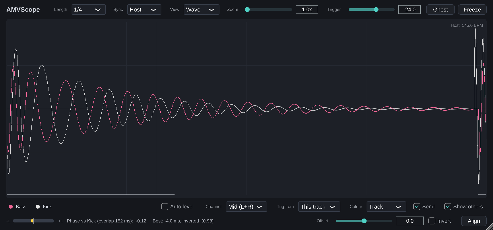
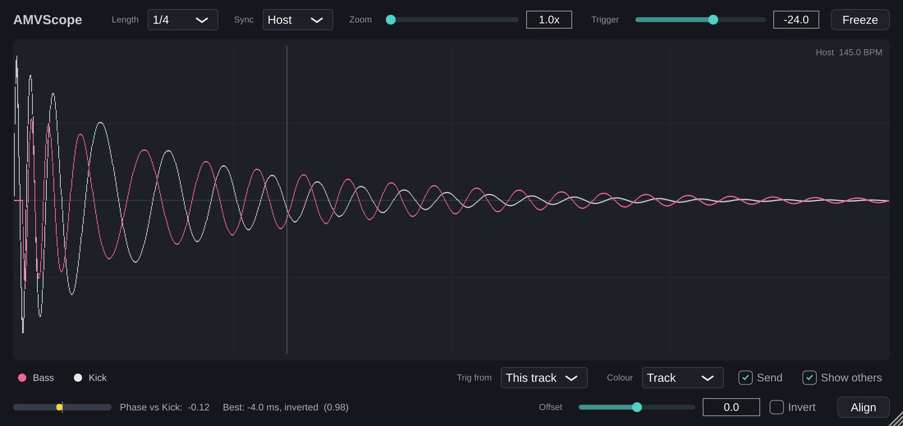
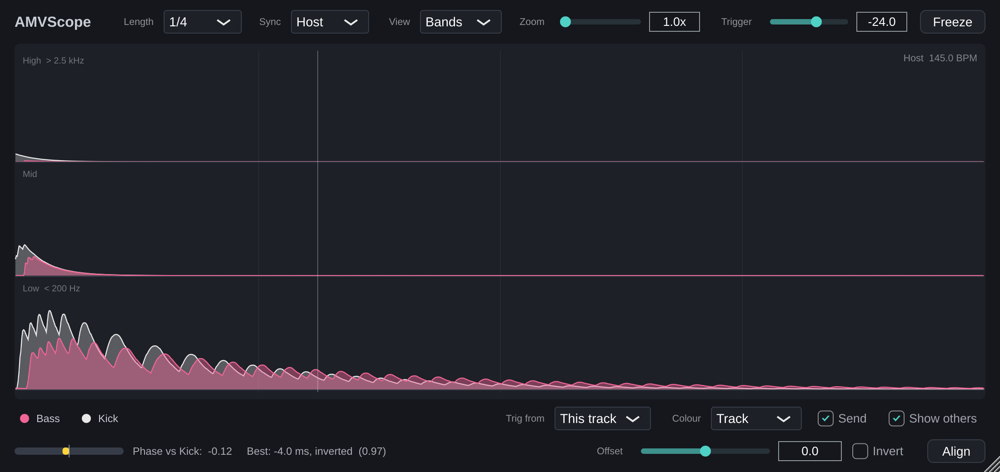
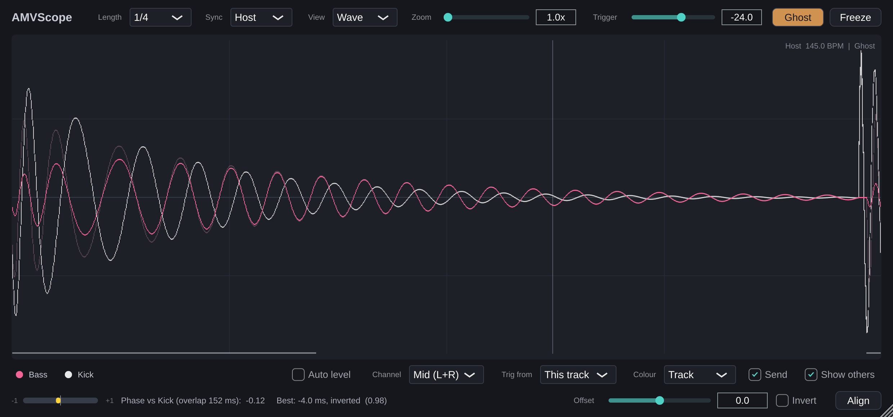
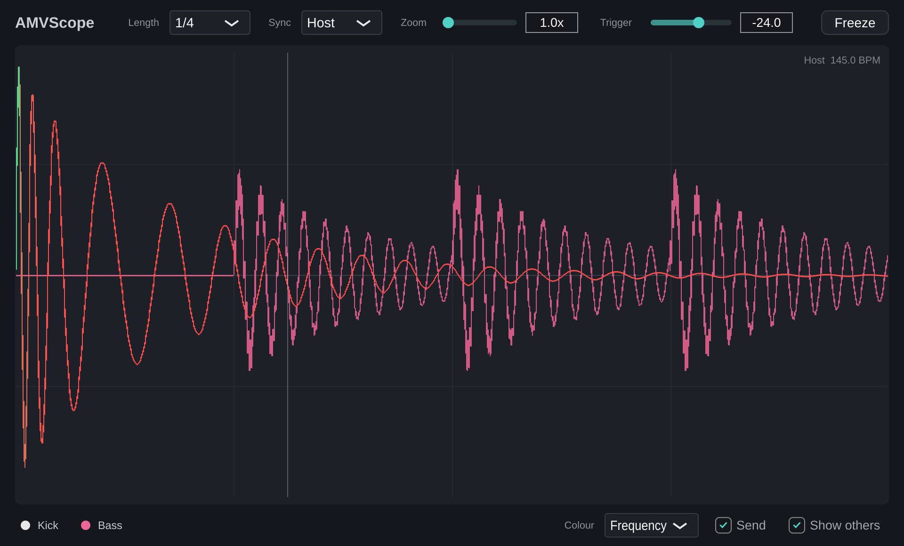

# AMVScope

VST3 osciloskop plugin za Windows i macOS, pravljen za Bitwig Studio, po uzoru na Oszillos Mega Scope.
Glavna namena je provera kicka i basa: kako se talasni oblici poklapaju u vremenu i fazi.



## Šta radi (verzija 0.6)

- **Prikaz sinhronizovan sa tempom:** dok Bitwig svira, talasni oblik se crta na mestu u taktu, pa slika stoji mirno dok se muzika ponavlja. Udarac kicka je uvek na istom mestu, a bas posle njega se vidi tačno u odnosu na kick.
- **Length:** dužina prikaza 1/16, 1/8, 1/4, 1/2, 1 takt, 2 ili 4 takta (prati takt projekta, npr. 3/4). Za kick i bas je obično najbolje 1/4.
- **Sync:** *Host* prati Bitwig dok svira, a kad je transport zaustavljen prelazi na okidanje po nivou. *Trigger* uvek okida po nivou.
- **Trigger:** nivo (u dB) na kom počinje crtanje kad se ne prati transport; narandžaste isprekidane linije ga prikazuju na ekranu.
- **Zoom:** uvećanje po visini (1x do 32x), za tihe signale ili detalje repa kicka.
- **Freeze:** zamrzava sliku da bi se mirno pogledala.
- **Više signala jedan preko drugog:**
  - **Druge AMVScope instance:** stavi AMVScope na traku sa kickom i na traku sa basom. U svakom prozoru se vidi i signal sa druge trake, sa imenom i bojom trake iz Bitwiga. *Send* određuje da li ostale instance vide ovu traku, a *Show others* da li ova prikazuje ostale. Radi dok se prati transport (Host).
  - **Sidechain:** signal doveden na sidechain ulaz plugina crta se narandžasto, i u Host i u Trigger režimu.
  - Klik na ime u legendi dole levo sakriva ili prikazuje taj signal.
- **Colour:** *Track* (svaki signal u boji svoje trake) ili *Frequency* (ova traka obojena po sadržaju: crveno niske, zeleno srednje, plavo visoke frekvencije).
- **Faza (donji red):** merač pokazuje koliko se ova traka slaže sa drugim signalom na ekranu (prvi vidljivi: sidechain ili druga instanca). `+1` znači da se talasi poklapaju i sabiraju, `0` da nemaju veze, `-1` da se poništavaju. Pored piše i predlog: za koliko ms treba pomeriti ovu traku (i da li okrenuti polaritet) da slaganje bude najbolje.
  - **Offset** pomera ovu traku na ekranu (u ms, plus znači kasnije), **Invert** joj okreće polaritet, a **Align** postavlja oba na predloženu vrednost. Pomak vide i ostale instance.
  - Ovo menja samo prikaz, ne i zvuk. Kad nađeš vrednost koja ti odgovara, isti pomak podesi u Bitwigu (kašnjenje trake ili *Time Shift* uređaj) i polaritet po potrebi.
  - Merač radi kad je *Length* 1/2 ili kraće. Faza se računa samo u delu gde oba signala sviraju u isto vreme (npr. rep kicka ispod početka basa); taj deo je obeležen tankom linijom na dnu prikaza, a njegova dužina piše pored merača. Ako takvog dela nema (bas počinje tek kad kick utihne), piše da se signali ne preklapaju i *Align* ne radi ništa, jer tada nema šta da se poravna.



- **View → Bands:** umesto talasnog oblika, tri reda pokazuju nivo visokih (iznad 2.5 kHz), srednjih i niskih (ispod 200 Hz) frekvencija za svaki signal. Tako se vidi gde se kick i bas preklapaju u niskim i koliko dugo traje klik kicka. Taster `B` menja prikaz.



- **Ghost (pre i posle):** dugme *Ghost* (ili taster `G`) zapamti sliku kakva je sada i ostavi je bledo iza živog signala. Promeni nešto (pomeri kick, podesi sidechain kompresiju ili EQ) i odmah vidiš razliku. Još jedan klik uklanja zapamćenu sliku. Slika se čuva dok je projekat otvoren i prikazuje se samo uz *Length* na kom je zapamćena.
- **Visina signala:**
  - **Auto level** (taster `A`) crta sve signale u istoj visini, pa se oblik tihog basa vidi jednako dobro kao glasan kick.
  - **Točkić miša preko imena u legendi** podiže ili spušta samo taj signal (1 dB po koraku, do ±36 dB); dupli klik na ime vraća na normalu.
  - Pored imena piše koliko je signal podignut ili spušten. Ovo menja samo prikaz. Dok je neki signal podignut ili spušten, merenje mišem pokazuje samo vreme, bez nivoa u dB.



- **Merenje mišem:** pomeranjem miša preko prikaza vidiš vreme od početka prozora (ms) i nivo (dB). Prevuci mišem da izmeriš razmak između dve tačke, u ms i Hz (npr. dužinu repa kicka ili jednu periodu basa). Klik briše merenje.
- **Zoom točkićem** miša preko prikaza; dupli klik vraća na 1x.
- **Trig from:** u Trigger režimu sliku može da pokreće i sidechain (npr. kick pokreće prikaz basa).
- **Prozor** se može povećati povlačenjem donjeg desnog ugla; veličina i sakriveni signali se pamte u projektu.
- **Tasteri** (klikni prvo na prikaz): `1`-`7` dužina, `F` ili razmak freeze, `S` sync, `C` boje, `B` prikaz po opsezima, `G` ghost, `A` auto level, `O` ostale instance, `+`/`-` ili strelice zoom, `Esc` briše merenje.
- Plugin ne menja zvuk; podešavanja se pamte u projektu.



**Napomena za Bitwig:** instance se vide međusobno samo ako ih Bitwig pokreće u istom procesu. Ako se druge trake ne pojavljuju, u *Settings > Plug-ins* promeni *Plug-in hosting mode* tako da ne bude *Individually* (ili isto podesi za AMVScope pojedinačno).

## Plan

- [x] Kostur: CMake/JUCE projekat, build na GitHub-u, instaleri
- [x] v0.1: talasni oblik sinhronizovan sa tempom (1/16 do 4 takta), zoom po amplitudi, freeze, trigger po nivou kad transport ne svira
- [x] v0.2: više signala (sidechain ulaz ili deljenje između instanci), prikaz jedan preko drugog u bojama, bojenje po frekvenciji
- [x] v0.3: promenljiva veličina prozora, tasteri, podešavanja koja se pamte u projektu
- [x] v0.4: faza između traka (korelacija, pomak, polaritet, predlog poravnanja)
- [x] v0.5: prikaz po opsezima (niske, srednje, visoke odvojeno)
- [x] v0.6: poređenje pre i posle (ghost), visina po signalu i auto level

## Preuzimanje i instalacija

Poslednja verzija sa instalerom za Windows i Mac nalazi se na stranici **[Releases](../../releases/latest)**.

- Windows: preuzmi i pokreni `AMVScope-...-Windows-Setup.exe`.
- Mac: preuzmi `AMVScope-...-macOS.pkg`, desni klik, pa *Open*.

Instaleri nisu potpisani, pa sistem prikaže upozorenje pri prvom pokretanju. Detalji i ručna instalacija su u [docs/INSTALL.txt](docs/INSTALL.txt).

## Za razvoj

Potrebni su CMake 3.22+ i C++20 kompajler. JUCE se preuzima automatski.

```
cmake -S . -B build -DCMAKE_BUILD_TYPE=Release
cmake --build build --config Release
ctest --test-dir build -C Release --output-on-failure
```

- `src/dsp/`: jezgro u čistom C++-u, bez JUCE-a (`PpqRing` pamti signal po poziciji u taktu, `SyncedCapture` jedan prozor u trigger režimu, `TriggerDetector` okidanje po nivou, `BandSplitter` nivoi niskih/srednjih/visokih), testira se bez DAW-a (`tests/DspTests.cpp`).
- `src/plugin/`: JUCE plugin (procesor, prozor i `SharedSources`, preko kog se instance vide).
- `tests/PluginTests.cpp`: pokreće pravi procesor bez DAW-a.

## Licenca

AMVScope je slobodan softver pod licencom [GNU AGPLv3](LICENSE). Koristi [JUCE](https://juce.com), koji je za open-source projekte dostupan pod istom licencom.

## Code signing policy

Free code signing provided by [SignPath.io](https://about.signpath.io/), certificate by [SignPath Foundation](https://signpath.org/).

Pravila potpisivanja, uloge u timu, privatnost i deinstalacija opisani su u [CODE_SIGNING.md](CODE_SIGNING.md). Plugin ne šalje nikakve podatke preko mreže.
